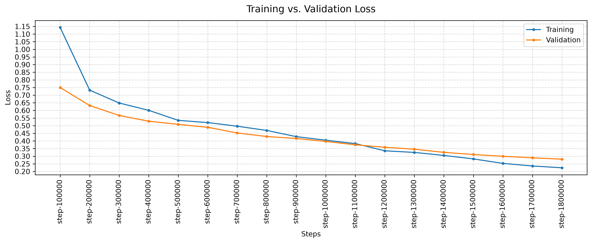
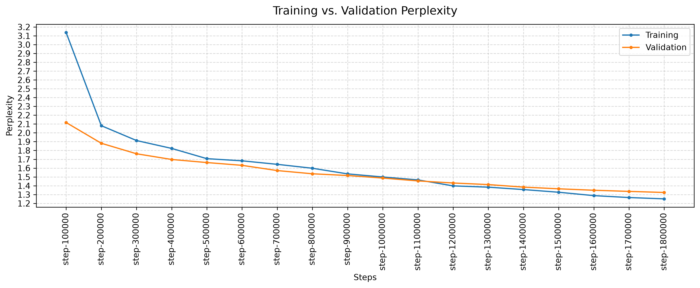
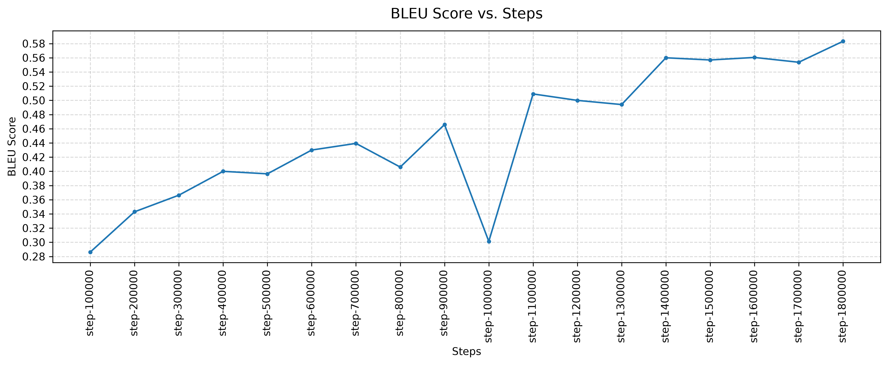
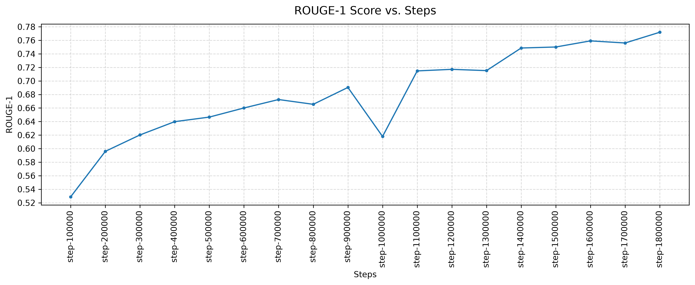
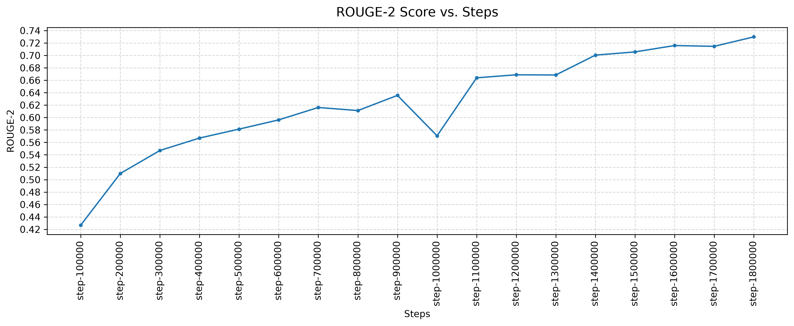
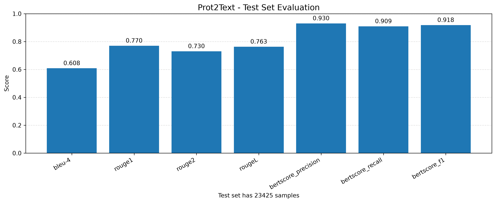

# ProtBuild

ProtBuild is a research project focused on learning the language of protein sequences and developing models that can understand and describe their properties and functions.

The project explores the connection between protein sequence representations and natural-language descriptions. Its current implementation focuses on **protein-to-text generation**, using pretrained protein and language models to generate textual descriptions of protein sequences.

The long-term goal is to build a system that connects **protein sequences, their learned representations, and natural-language descriptions**, providing a foundation for protein understanding and, eventually, protein design.

## Overview

The current implementation focuses on the Prot2Text task: generating natural-language descriptions from amino-acid sequences.

The model combines a pretrained protein language model with a pretrained causal language model. Protein representations are projected into the language model's hidden space and provided to the language model through cross-attention.

The project includes:

- Protein sequence encoding using a pretrained protein language model.
- Protein-conditioned natural-language generation.
- Training and validation pipelines for protein-to-text generation.
- Evaluation using lexical-overlap and semantic-similarity metrics.
- Visualization of training and evaluation results.

## Model Architecture

The current implementation uses the following pretrained models:

| Component | Model |
|---|---|
| Protein encoder | `facebook/esm2_t6_8M_UR50D` |
| Text generation model | `openai-community/gpt2` |

The protein encoder converts an amino-acid sequence into contextualized representations. A trainable projection module maps these representations into the hidden space expected by the text generation model.

The projected protein representations are supplied to GPT-2 through cross-attention, allowing the language model to condition its generated descriptions on the input protein sequence.

The projection module includes linear transformations, a SiLU activation, dropout, and RMS normalization.

## Dataset

The experiments use the **ProtDAT** dataset.

- **Dataset source:** [ProtDAT — Zenodo](https://zenodo.org/records/14967237)
- **Training format:** JSONL
- **Input:** Protein amino-acid sequence
- **Target:** Natural-language protein description

The dataset was shuffled during the splitting process and subsequently converted into JSONL files. The training pipeline consumes these prepared files.

### Dataset Splitting

The dataset was divided into training, validation, and test subsets using a 90/5/5 split.

| Subset | Split ratio | Number of samples |
|---|---:|---:|
| Training | 90% | 421,626 |
| Validation | 5% | 23,423 |
| Test | 5% | 23,425 |

The subsets were shuffled during preparation before being written to their respective JSONL files.

### Iterable Dataset

The prepared datasets are loaded using an `IterableDataset` implementation.

During training, samples are streamed from the JSONL files rather than relying on a conventional map-style dataset. During validation, the full validation split contains 23,423 samples, but each validation run evaluates a subset of **2,000 samples**, using a batch size of 1.

Consequently, the reported validation metrics represent the evaluated subset at each validation checkpoint rather than a complete evaluation over all 23,423 validation samples.

## Training Configuration

The model was trained for **5 epochs**.

| Parameter | Value |
|---|---|
| Number of epochs | 5 |
| Training samples | 421,626 |
| Validation samples available | 23,423 |
| Samples evaluated per validation run | 2,000 |
| Validation batch size | 1 |
| Validation frequency | Every 100,000 training steps |
| Total validation runs | 18 |

Validation was performed periodically during training, with an evaluation interval of 100,000 training steps. Across the complete training process, 18 validation runs were performed.

Each validation run evaluated 2,000 samples from the validation dataset.

## Results

Training curves and final test-set evaluation results are available in:

[`ml/notebooks/plots/`](ml/notebooks/plots/)

The plots include training and validation loss, perplexity, and evaluation metrics where available.

### Final Test Set Evaluation

The final evaluation was performed on **23,425 test samples**.

| Metric | Score |
|---|---:|
| BLEU-4 | 0.6085 |
| ROUGE-1 | 0.7703 |
| ROUGE-2 | 0.7304 |
| ROUGE-L | 0.7631 |
| BERTScore Precision | 0.9305 |
| BERTScore Recall | 0.9094 |
| BERTScore F1 | 0.9182 |

These metrics measure different aspects of the generated descriptions. BLEU and ROUGE quantify lexical overlap with reference descriptions, while BERTScore estimates semantic similarity using contextual embeddings.

The scores provide a quantitative assessment of the model's generated descriptions. However, they do not independently establish the biological correctness of the generated information.

### Visualizations

Training and evaluation plots are maintained in the [`ml/notebooks/plots/`](ml/notebooks/plots/) directory.

For example, if the corresponding image files exist in that directory:

## Evaluation Metrics

- **BLEU-4:** Measures n-gram overlap between generated and reference descriptions, up to four-grams.
- **ROUGE-1:** Measures unigram overlap.
- **ROUGE-2:** Measures bigram overlap.
- **ROUGE-L:** Measures overlap based on the longest common subsequence.
- **BERTScore Precision:** Measures contextual similarity between generated and reference tokens, emphasizing the generated description.
- **BERTScore Recall:** Measures contextual similarity from the perspective of the reference description.
- **BERTScore F1:** Combines BERTScore precision and recall into a single score.

### BERTScore Configuration

BERTScore was used to evaluate the semantic similarity between generated protein descriptions and their reference descriptions.

The pretrained model used for BERTScore evaluation was [`dmis-lab/biobert-v1.1`](https://huggingface.co/dmis-lab/biobert-v1.1), a biomedical language model based on BERT.

BioBERT provides contextual representations of biomedical text, making it a relevant choice for evaluating descriptions in a biomedical domain.

The evaluation reports the following BERTScore metrics:

- **Precision:** Semantic similarity from the perspective of the generated description.
- **Recall:** Semantic similarity from the perspective of the reference description.
- **F1:** The harmonic mean of BERTScore precision and recall.

The BioBERT model was used exclusively for evaluation and was not part of the Prot2Text training architecture.

## References

### ProtDAT

The dataset used in these experiments:

- [ProtDAT — Zenodo](https://zenodo.org/records/14967237)

### Prot2Text

This project was also inspired by the Prot2Text implementation and pretrained model published on Hugging Face:

- [Prot2Text-Base-v1-0 — Hugging Face](https://huggingface.co/habdine/Prot2Text-Base-v1-0)

The linked repository includes a reference to the associated research paper. It served as a starting point for exploring protein-to-text generation in this project.

ProtBuild is an independent experimental implementation and should not be interpreted as a reproduction of the original work unless the relevant configurations and experimental procedures have been verified to match.
